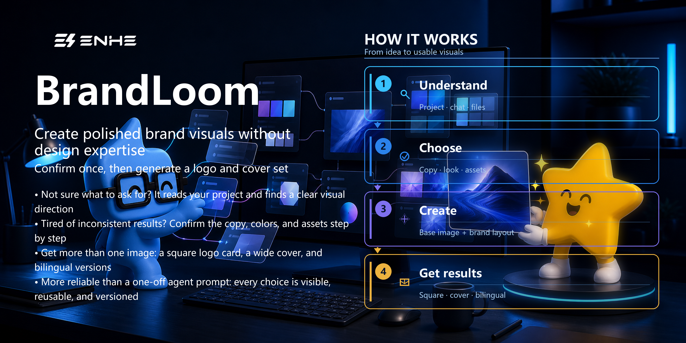
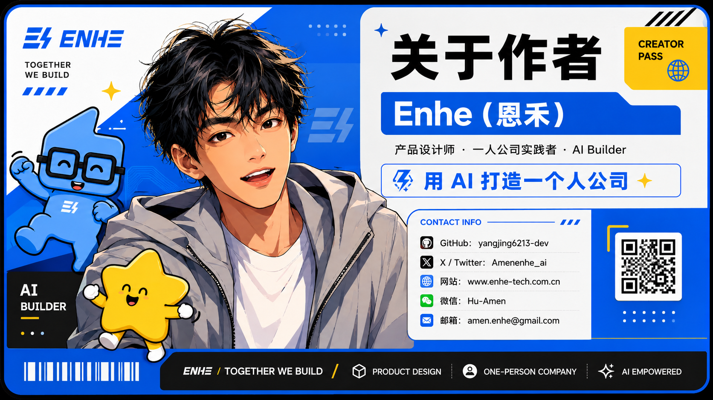

# BrandLoom

[简体中文](README.md) | [English](README.en.md)

<p align="center">
  
</p>

BrandLoom is a Codex Skill for confirmation-driven brand-visual workflows. It
confirms the target platform and cover dimensions first, then reviews project
copy, style, typography, brand assets, and usage rights. The updated workflow
produces platform covers only; it no longer generates a square logo key visual.
Each QA turn shows explicit choices and gives a project-specific recommendation
with its reason.

BrandLoom is not a one-shot image prompt. It is a local-first, confirmable,
reusable, and auditable visual workflow.
Changes are re-confirmed through an invalidation matrix so that only affected
choices need to be revisited.

Platform-cover targets defined by QA:

- YouTube video thumbnail: 3840×2160; Shorts cover: 2160×3840; channel banner: 2560×1440
- Douyin work cover: 1080×1440 (practical recommendation, not an official fixed pixel requirement)
- Xiaohongshu note cover: 1080×1440 (common recommendation, not a unique official pixel spec)
- GitHub Social Preview: 1280×640
- Custom width and height can be confirmed per output

Platform covers now have target-specific layouts, composition, review, and
delivery. A base is proportionally resized only when its aspect ratio exactly
matches the target; it is never cropped or stretched. Custom-size limits are in
the [output specifications](brandloom/references/output-specs.md).

## 1. What is this repository?

This repository contains the installable `brandloom` Codex Skill and its
supporting components:

- QA state machine and task routing
- Brand profiles, asset library, and rights provenance
- Copy, style, typography, and composition reference rules
- JSON templates and generation manifests
- Deterministic Pillow typography and image-composition scripts
- Automated tests, example images, and the release-package build script

BrandLoom understands the project first, confirms visual decisions, and then
produces the visual assets.

## 2. Who is it for?

### 2.1 Especially suitable for

- Solo companies, independent developers, and AI Builders
- Product designers, brand designers, and content creators
- People who need a consistent visual system for a GitHub project, Skill,
  software product, or digital product
- People with an existing company logo, project mark, IP, or reference material
  that must be reused over time
- Projects that need Chinese, English, or bilingual visual versions
- Anyone who values asset rights, version history, and repeatable delivery

### 2.2 Not suitable for

- A one-sentence, instant-image workflow with no confirmation steps
- Projects that cannot verify asset ownership or authorization
- Situations that require an image model to redraw an official company logo
- Automatic trademark registration, Figma cloud collaboration, cloud
  publishing, or dozens of platform-specific sizes generated in bulk
- Automatically publishing generated content without human review

## 3. What does it produce?

BrandLoom can produce:

- Covers for YouTube, Douyin, Xiaohongshu, GitHub, and user-confirmed custom sizes
- Platform-specific copy, language, real-scene composition, and JSON manifests
- Chinese, English, and Chinese-English bilingual versions
- Cover-only outputs and visual variants
- IP combinations confirmed for each platform cover
- Project marks, deterministic copy layout, and feature information
- Generation manifests, input-asset hashes, output paths, and version records
- Copy directions, shot lists, and image prompts through the `plan-only` route

The built-in IP options are `author-anime`, `tuotuo`, and `xingbi`. They are
equal-level choices and support three single-IP options, three pairs, and one
all-three combination (seven combinations in total).

## 4. What value does it provide?

- **Visual consistency:** The company logo, project mark, IP, typography, and
  copy follow one brand profile.
- **Composition that fits the scene:** Choose from four visual directions. In
  the stage-screen style, the headline stays outside the display while other
  copy follows the screen edges, perspective, and spacing so it reads as
  screen content rather than floating captions.
- **Controlled typography:** Critical Chinese and English text is laid out
  deterministically with Pillow, reducing text errors from image generation.
- **Traceable assets:** Source, SHA-256, authorization status, storage scope,
  and default scope are recorded.
- **Reusable workflow:** Confirmed brand choices can be reused for localization,
  edits, and later variants.
- **Clear risk boundary:** Image tools are not called before
  `GENERATION_READY`.
- **Local-first operation:** Runtime state, templates, brand profiles, and
  manifests use JSON; the asset library is not uploaded and telemetry is not
  enabled.
- **Explicit failure boundary:** If the image tool is unavailable or fails,
  the workflow hard-stops without requesting an API key or switching services.

## 5. Example results

The following two images are BrandLoom-generated examples, stacked vertically: a 1254×1254 square key visual above a 1774×887 horizontal cover. The square image is from an earlier workflow; the current QA produces platform-specific covers only.

<p align="center">
  
</p>

<p align="center">
  
</p>

## 6. Installation

### Install from source

Python 3.12 or newer is required.

```bash
git clone https://github.com/yangjing6213-dev/project-brand-studio.git
cd project-brand-studio
python -m pip install -r requirements-runtime.txt
```

Copy the repository's `brandloom/` directory into the Codex skills directory:

```text
<CODEX_HOME>/skills/brandloom/
```

Reopen the workspace to make the Skill available.

### Build the release package

```bash
python scripts/build_skill_package.py
```

The output is `dist/brandloom.zip`. The package contains only releasable
`brandloom/` content; development state, tests, staging assets, and local
generated output are excluded.

### Local development and verification

```powershell
python -m pip install -r requirements-runtime.txt
python -m unittest discover -s tests -p "test_*.py" -v
python -m compileall -q brandloom tests
python -m pip check
python scripts/build_skill_package.py
```

## 7. How to use it

In Codex, enter:

```text
Use $brandloom
```

For example:

```text
Use $brandloom to make Chinese covers for YouTube, Douyin, Xiaohongshu, and GitHub for my open-source project.
```

BrandLoom provides these Skill routes:

- `new`: establish brand visuals for a new project
- `edit`: modify existing visuals while preserving unchanged confirmations
- `localize`: reuse a confirmed base image for another language
- `variant`: create a platform, size, or style variant
- `plan-only`: output only copy, composition, and prompt plans
- `analysis-only`: analyze project context and unresolved decisions
- `custom-IP`: onboard custom IP through the rights and storage-scope flow

`analysis-only` and `custom-IP` are Skill conversation routes, not `TaskMode`
values accepted by `brandloom_cli.py`.

The updated QA first confirms the target platform and dimensions, then moves to
copy and visual design. Platform targets can be multi-selected; YouTube must be
specified as a video thumbnail, Shorts cover, or channel banner.

## 8. Project workflow

```text
Analyze the project and accessible materials
        ↓
Ask one confirmation question at a time
        ↓
Confirm target platforms and sizes first, then copy, style, typography, brand assets, IP, and composition
        ↓
Confirm asset rights, storage scope, and default scope
        ↓
Reach GENERATION_READY
        ↓
Call the host's built-in image tool for a base image without critical text
        ↓
Validate the returned path, readability, aspect ratio, and dimensions
        ↓
Use Pillow to compose the logo, project mark, and critical text
        ↓
Run internal QA
        ↓
Generate, compose, review, and deliver each selected platform cover separately
        ↓
Finish only after every selected platform cover passes
```

The new workflow does not generate a square logo key visual. If confirmed by
the user, the original company logo may still be placed on covers without
stretching or changing its letterforms.

## 9. Repository structure

```text
project-brand-studio/
├─ brandloom/
│  ├─ SKILL.md
│  ├─ USAGE.md
│  ├─ agents/
│  ├─ assets/
│  │  └─ defaults/
│  ├─ references/
│  ├─ templates/
│  └─ scripts/
│     ├─ brandloom_cli.py
│     └─ brandloom_core/
├─ docs/
│  ├─ examples/
│  └─ images/
├─ scripts/
│  └─ build_skill_package.py
├─ tests/
├─ .github/
│  └─ workflows/
├─ README.md
├─ README.en.md
├─ NOTICE.md
├─ LICENSE
└─ requirements-runtime.txt
```

The following paths are for local development or runtime only and are not
automatically added to Git:

```text
.brandloom/
staging/brand-assets/
dist/
```

## 10. Implementation notes and boundaries

- The minimum Python version is 3.12.
- The only runtime third-party dependency is `Pillow==12.3.0`.
- Runtime state, templates, brand profiles, and manifests use JSON; no YAML
  parser dependency is added.
- The official company logo must come from the confirmed original file. It may
  be scaled proportionally, but it is never redrawn by an image model and its
  typeform or geometry is not changed.
- Critical Chinese and English text uses deterministic Pillow layout.
- Image generation may use only the host's built-in image tool.
- If the tool is unavailable or fails, returns an empty path, produces an
  unreadable file, or returns a mismatched aspect ratio, the workflow hard-stops.
- BrandLoom never requests an API key and never switches to the Images API,
  another SDK, a third-party service, or a recursive Codex call.
- Original assets, generated files, and historical versions are never
  overwritten.
- Every uploaded asset must have confirmed usage rights, storage scope, and
  default scope.
- The public package contains only assets with provenance,
  `authorization_status` set to `user_authorized`, and
  `distribution_scope` set to `public_skill_package`.
- Third-party commercial reference posters may inform abstract style only; they
  do not enter the public release package.
- Custom dimensions are supported by the CLI and local JSON templates: 320–8192
  pixels per side and no more than 16 megapixels total. A mismatched aspect
  ratio stops; cropping or stretching is not used to force a pass.
- Generated content must receive human review before external publication, with
  AI participation disclosed when appropriate.
- Source code and documentation use the MIT License. Rights for the company
  logo, IP, and example images are defined by `NOTICE.md` and their individual
  provenance records.

## 11. Related projects

- Direct runtime dependencies: none.
- Workflow reference: `cognitive-anchor-sketcher`, used only as a reference for
  QA state machines, Skill organization, and illustration-generation flow; it
  is not a BrandLoom runtime dependency.

## 12. About the author



### 1. Enhe (恩禾)

Product designer · One-person company practitioner · AI Builder

Building a one-person company with AI.

- GitHub: [@yangjing6213-dev](https://github.com/yangjing6213-dev)
- X/Twitter: [@Amenenhe_ai](https://x.com/Amenenhe_ai)
- Website: [www.enhe-tech.com.cn](https://www.enhe-tech.com.cn/)
- WeChat: Hu-Amen
- Email: [amen.enhe@gmail.com](mailto:amen.enhe@gmail.com)

[Enhe ENHE AI | AI tools, AI news, account services, and skill courses](https://www.enhe-tech.com.cn/)

## 13. Keep exploring

BrandLoom is one tool in a personal generation system built with AI.

If you are also using AI for content, knowledge bases, workflows, or
productization, visit the website for more resources:

[www.enhe-tech.com.cn](https://www.enhe-tech.com.cn/)
