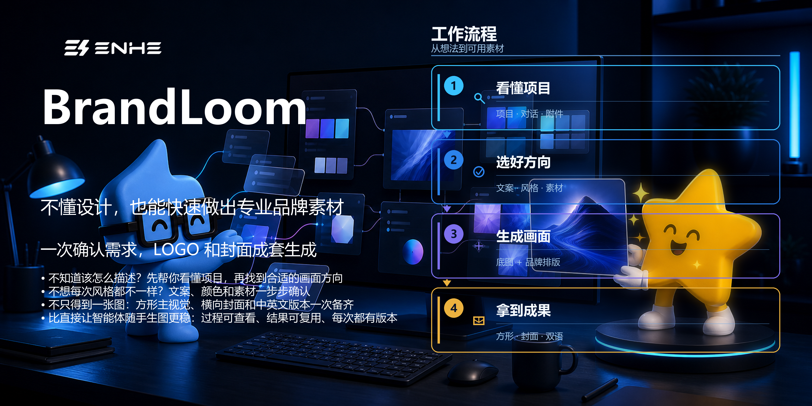

# BrandLoom

[简体中文](README.md) | [English](README.en.md)

<p align="center">
  
</p>

BrandLoom 是一个面向 Codex 的品牌视觉工作流 Skill。它通过一次一个问题的确认式 QA，先确认目标平台和封面尺寸，再整理项目文案、风格、字体、品牌素材与使用权；每轮都会明确显示可选项，并根据项目用途给出有理由的推荐。新流程只生成平台封面，不生成 LOGO 方形主视觉。

BrandLoom 不是一段一次性生图提示词，而是一套本地优先、可确认、可复用、可审计的品牌视觉流程。
变更会按失效矩阵重新确认受影响的选择。

QA 规格中定义的平台封面目标：

- YouTube 长视频缩略图：3840×2160；Shorts 封面：2160×3840；频道横幅：2560×1440
- 抖音作品封面：1080×1440（实用建议值，不是官方固定像素要求）
- 小红书笔记封面：1080×1440（常用建议值，不是官方唯一像素规格）
- GitHub Social Preview：1280×640
- 允许逐项确认自定义宽、高像素

平台封面现已支持按各目标尺寸分别排版、合成、验收和交付；底图只有比例与目标完全一致时才会等比例缩放，不裁切、不拉伸。自定义尺寸限制见[输出规格](brandloom/references/output-specs.md)。

## 一、这个仓库是什么？

这个仓库包含可安装的 `brandloom` Codex Skill，以及它所需的：

- QA 状态机与任务路由
- 品牌档案、素材库和授权 provenance
- 文案、风格、字体和构图参考规则
- JSON 模板与生成 manifest
- Pillow 确定性排版和图像合成脚本
- 自动化测试、示例图片和发行包构建脚本

BrandLoom 会先理解项目，再确认视觉决策，最后生成视觉资产。

## 二、适合谁用？

### 1、特别适合

- 一人公司、独立开发者和 AI Builder
- 产品设计师、品牌设计师和内容创作者
- 需要为 GitHub 项目、Skill、软件或数字产品建立统一视觉的人
- 已有公司 LOGO、项目标志、IP 或参考素材，需要持续复用的人
- 需要中文、英文或双语视觉版本的人
- 重视素材权利、版本记录和可重复交付的人

### 2、不适合

- 只想“一句话立即生成图片”、不愿完成确认流程的人
- 没有素材使用权或无法确认授权状态的项目
- 需要图片模型重新绘制正式公司 LOGO 的场景
- 需要自动商标注册、Figma 云协作、云端发布或批量生成几十种平台尺寸的场景
- 需要未经人工复核就自动公开发布生成内容的场景

## 三、它会产出什么？

BrandLoom 可以产出：

- YouTube、抖音、小红书、GitHub 和用户自定义尺寸的封面
- 每个平台独立的文案、语言、真实场景构图和 JSON manifest
- 中文、英文和中英双语版本
- 仅封面和视觉变体
- 按平台分别确认的 IP 组合
- 项目标志、确定性排版文案和功能信息
- 生成 manifest、输入素材哈希、输出路径和版本记录
- `plan-only` 路由下的文案方向、shot list 和图片提示词

内置 IP 为 `author-anime`、`tuotuo` 和 `xingbi`，三者同等级可选，支持单独、两两和三者共七种组合。

## 四、具有什么价值？

- **视觉一致性**：公司 LOGO、项目标志、IP、字体和文案遵循同一个品牌档案。
- **构图贴合场景**：主视觉提供四种风格方向；舞台大屏风格把标题放在屏幕外，其他文案按屏幕边界、透视和留白排进屏幕内容区，避免看起来像悬浮字幕。
- **文字可控**：关键中英文文字由 Pillow 确定性排版，减少图片模型生成错字。
- **素材可追溯**：记录来源、SHA-256、授权状态、保存范围和默认范围。
- **流程可复用**：确认过的品牌选择可以用于本地化、编辑和后续变体。
- **风险更可控**：未达到 `GENERATION_READY` 前不会调用图片工具。
- **本地优先**：运行时状态、模板、品牌档案和 manifest 使用 JSON，不上传素材库，也不启用遥测。
- **失败边界清晰**：图片工具不可用或失败时硬停止，不索取 API Key，也不切换其他服务。

## 五、示例效果

以下两张图例为 BrandLoom Skill 生成的图例，按上下排列：上图为 1254×1254 方形主视觉，下图为 1774×887 横向封面。方形图来自旧版流程；当前新 QA 只生成适配各平台的封面。

<p align="center">
  
</p>

<p align="center">
  
</p>

## 六、安装方法

### 从源码安装

需要 Python 3.12 或更高版本。

```bash
git clone https://github.com/yangjing6213-dev/project-brand-studio.git
cd project-brand-studio
python -m pip install -r requirements-runtime.txt
```

将仓库中的 `brandloom/` 目录复制到 Codex skills 目录：

```text
<CODEX_HOME>/skills/brandloom/
```

重新打开工作区后即可调用 Skill。

### 构建发行包

```bash
python scripts/build_skill_package.py
```

构建结果为 `dist/brandloom.zip`。发行包只包含 `brandloom/` 的可发行内容，不包含开发状态、测试、staging 素材或本地生成输出。

### 本地开发与验证

```powershell
python -m pip install -r requirements-runtime.txt
python -m unittest discover -s tests -p "test_*.py" -v
python -m compileall -q brandloom tests
python -m pip check
python scripts/build_skill_package.py
```

## 七、如何使用？

在 Codex 中输入：

```text
Use $brandloom
```

例如：

```text
Use $brandloom，为我的开源项目制作适配 YouTube、抖音、小红书和 GitHub 的中文封面。
```

BrandLoom 的 Skill 路由包括：

- `new`：为新项目建立品牌视觉
- `edit`：修改已有视觉并保留未变更的确认
- `localize`：复用已确认底图生成其他语言版本
- `variant`：生成新的平台、尺寸或风格变体
- `plan-only`：只输出文案、构图和提示词计划
- `analysis-only`：只分析项目上下文和未确认事项
- `custom-IP`：按权利和保存范围流程接入自定义 IP

其中 `analysis-only` 与 `custom-IP` 是 Skill 对话路由，不是 `brandloom_cli.py` 的 TaskMode 参数。

新 QA 首先确认平台用途与尺寸，再确认文案和视觉设计；平台目标可多选，YouTube 需说明是长视频缩略图、Shorts 封面还是频道横幅。

## 八、项目工作流程

```text
分析项目与可访问材料
        ↓
一次一个问题的确认式 QA
        ↓
先确认平台目标与尺寸，再确认文案、风格、字体、品牌素材、IP 和构图
        ↓
确认素材使用权、保存 scope 和默认 scope
        ↓
进入 GENERATION_READY
        ↓
调用宿主内置图片工具生成无关键文字底图
        ↓
验证返回路径、可读性、比例和尺寸
        ↓
使用 Pillow 合成 LOGO、项目标志和关键文字
        ↓
执行内部 QA
        ↓
为每个平台单独生成底图、合成、验收与交付
        ↓
所有已选平台通过后结束本次交付
```

新流程不生成方形 LOGO 主视觉；公司 LOGO 仍可在用户确认后作为封面元素使用，且必须保持原图比例和字形。

## 九、项目目录结构

```text
project-brand-studio/
├─ brandloom/
│  ├─ SKILL.md
│  ├─ USAGE.md
│  ├─ agents/
│  ├─ assets/
│  │  └─ defaults/
│  ├─ references/
│  ├─ templates/
│  └─ scripts/
│     ├─ brandloom_cli.py
│     └─ brandloom_core/
├─ docs/
│  ├─ examples/
│  └─ images/
├─ scripts/
│  └─ build_skill_package.py
├─ tests/
├─ .github/
│  └─ workflows/
├─ README.md
├─ README.en.md
├─ NOTICE.md
├─ LICENSE
└─ requirements-runtime.txt
```

以下目录仅用于本地开发或运行，不会自动加入 Git：

```text
.brandloom/
staging/brand-assets/
dist/
```

## 十、注意实现

- 最低 Python 版本为 3.12。
- 唯一运行时第三方依赖为 `Pillow==12.3.0`。
- 运行时状态、模板、品牌档案和 manifest 使用 JSON，不增加 YAML 解析依赖。
- 公司正式 LOGO 必须使用确认过的原始文件，只能等比缩放，不由图片模型重绘，也不改变字形或几何结构。
- 关键中英文文字使用 Pillow 确定性排版。
- 图片工具只能使用当前宿主提供的内置工具。
- 工具不可用、失败、返回空路径、文件不可读或尺寸不符时硬停止。
- 不请求 API Key，不切换 Images API、SDK、第三方服务或递归 Codex。
- 不覆盖原始素材、已生成文件或历史版本。
- 所有上传素材都必须确认使用权、保存 scope 和默认 scope。
- 公开发行包只包含具有 provenance、`authorization_status` 为 `user_authorized` 且 `distribution_scope` 为 `public_skill_package` 的资产。
- 第三方商业参考海报只能提炼抽象风格，不进入公开发行包。
- 自定义尺寸由 CLI 和本地 JSON 模板支持：每边 320–8192 像素、总像素不超过 1600 万；比例不匹配的底图会停止，不会靠裁切或拉伸通过。
- 生成内容对外发布前必须进行人工复核，并按需要说明 AI 参与。
- 源代码和文档适用 MIT License；公司 LOGO、IP 和示例图片的权利以 `NOTICE.md` 及各自 provenance 记录为准。

## 十一、相关项目

- 直接运行依赖：无。
- 工作流结构参考：`cognitive-anchor-sketcher`，仅作为 QA 状态机、Skill 组织和插图生成流程的参考，不是 BrandLoom 的运行时依赖。

## 十二、关于作者


### 1、Enhe（恩禾）

产品设计师 · 一人公司实践者 · AI Builder

用 AI 打造一个人公司。

- GitHub：[@yangjing6213-dev](https://github.com/yangjing6213-dev)
- X/Twitter：[@Amenenhe_ai](https://x.com/Amenenhe_ai)
- 网站：[www.enhe-tech.com.cn](https://www.enhe-tech.com.cn/)
- 微信：Hu-Amen
- 邮箱：[amen.enhe@gmail.com](mailto:amen.enhe@gmail.com)

[恩禾 ENHE AI｜AI 工具、AI 资讯、账号服务与技能课程](https://www.enhe-tech.com.cn/)

## 十三、继续探索

BrandLoom 是我用 AI 搭建的个人生成系统中的一个工具。

如果你也在用 AI 做内容、知识库、工作流或产品化，可以登录我的网站查看更多资料：

[www.enhe-tech.com.cn](https://www.enhe-tech.com.cn/)
